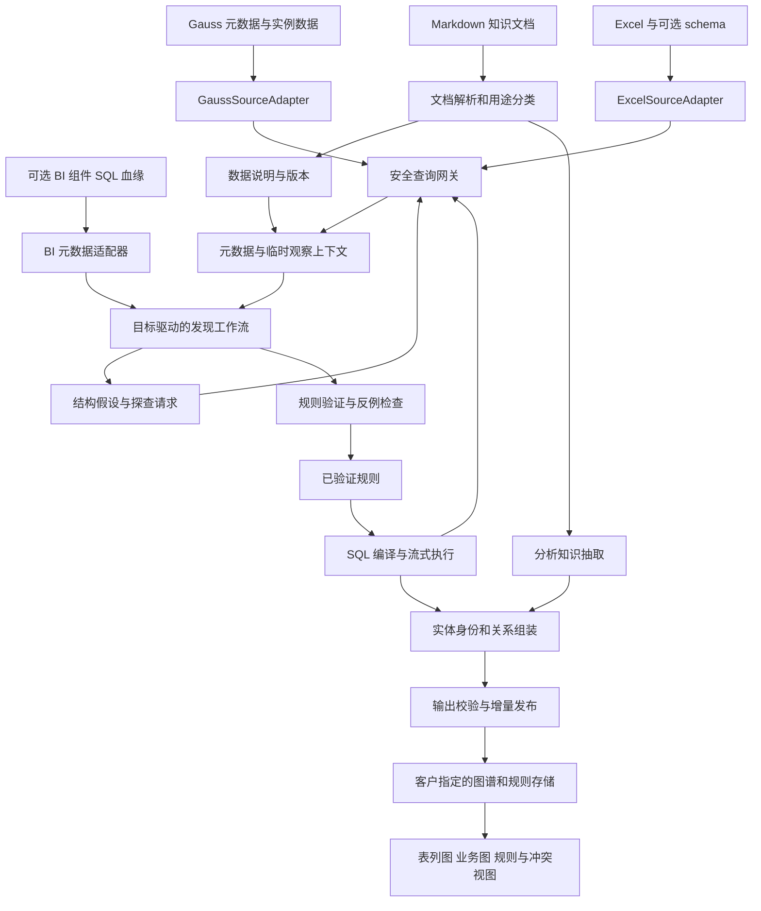

# SDD：Gauss、Excel 与知识文档驱动的轻量图谱

版本：0.1，2026-10-17。状态：待实现的设计，不是当前系统能力说明。

需求来源：本次用户需求、输入通道补充，以及“抽取结果可以保存，但数据库检索返回的数据不允许保存”的明确约束。代码现状见 [README](README.md)，用户验收见 [US](US.md)，开发顺序见 [实施计划](IMPLEMENTATION_PLAN.md)。

## 1. 范围与设计决策

### 1.1 输出目标

构建可解释、可增量维护的轻量属性图：

- 物理资产：数据库、表、列、上传文件与工作表。
- 业务知识：指标、度量、维度、成员、业务术语，以及文档中的分析方法和适用条件。
- 来源与规则：哪个列组产生哪个实体，哪个规则产生哪条边，来源范围、验证结论和有效版本。

不要求 OWL 推理、完整类继承树或每条定义派生一个本体类型。`Metric` 等是节点的类别标签；“销售费用”是一个业务实体。类型含义不足时可保留 `ReportItem` 或未确认类别，不凭 `report_item` 字段名强制归类。

第一阶段不抽取每条交易、订单或财务观测值。用户目标可以明确要求某些事实关系，但要单独声明粒度和规模预算。

### 1.2 核心决策

| 编号 | 决策 | 原因 |
| --- | --- | --- |
| D01 | 新建独立 `lightgraph` 主流程，局部复用两项目 | 避免继承本地全量导入、报表必选输入与类型归纳依赖 |
| D02 | 数据源使用 `SourceAdapter`，模型只调用有类型的探查算子 | SQL 安全、方言与查询成本统一管理 |
| D03 | 模型提出结构假设，程序寻找反例并验证规则 | 少量样本不能证明全表规律，也不能依靠命名直接决定语义 |
| D04 | 实体投影与关系投影分开，按目标粒度 DISTINCT | 去掉事实重复，同时保留关系两端的真实配对 |
| D05 | 语义身份与来源绑定、租户引用范围分离 | 同一指标跨范围共享，同名不同口径不误合并 |
| D06 | 数据说明文档与分析文档分别处理 | 前者解释结构，后者产生分析主张；证据地位不同 |
| D07 | 查询返回只在受限内存中消费；持久化仅经过输出契约 | 满足不保存数据库返回数据的要求 |
| D08 | 增量建立在图事实支持关系与规则依赖上 | 不引入原始查询结果缓存或逐行投影哈希库 |
| D09 | 数据不一致、预算不足和来源失效均显式报告 | 不把少量抽样成功或正常退出表示为完整发现 |

## 2. 系统结构与部署边界



数据访问与模型任务建议部署在客户环境。开发电脑不接收业务样本。源数据库账户只读；图谱结果存储使用独立连接和权限，绝不借源库账户写回。图存储可以先用客户侧关系表表示节点、边和支持关系，无需首期引入图数据库；导出 JSON 只包含已发布图结果。

“全部分析通过 SQL”适用于数据过滤、统计、依赖核验、去重、连接和投影。模型仍负责语义判定，程序负责 DSL 校验、图身份管理和发布。把自然语言理解也强行写成 SQL 不符合需求。

## 3. 输入契约与数据保留

### 3.1 结构化输入

```yaml
StructuredSource:
  id: source_001
  kind: gauss_database | excel_workbook
  connection_secret_ref: secret://customer/graph_reader
  allowed_objects: [catalog.schema.table]
  engine_profile:
    product: pending_detection
    version: pending_detection
    compatibility_mode: pending_detection
  schema_document_refs: []
```

数据库：读取授权范围内完整表列元数据、类型、注释、声明约束与可用统计。它们属于来源资料；转换为元数据图与认知文档后才能持久化，禁止顺手保存目录查询原始 JSON。完整元数据不等于一次全部放入模型上下文：按表/列组分包，记录覆盖范围。

Excel：工作簿/工作表是来源；表头与可选 schema 产生声明元数据，单元格产生观察。保留编码的前导零、空值、类型与单元格定位。合并表头、多个表区域、隐藏行列、公式缓存值、日期格式均需要解析规则；不执行宏、外部链接或公式。无缓存结果的公式单元格标为待处理。

Excel 在客户上传区保留原文件属于用户提供的输入；不得额外复制成 CSV/DuckDB 缓存。SQL 执行可以使用受限内存关系引擎，不允许 spill 到磁盘；超内存时报告限制，不能静默落盘。流式读取单个 Excel 文件可能仍需遍历文件，不能承诺像数据库索引一样随机取数。首期设置工作簿大小上限。

### 3.2 知识文档输入

```yaml
KnowledgeDocument:
  id: doc_001
  revision: v3
  media_type: text/markdown
  purpose: data_description | analysis_knowledge | mixed | unresolved
  applies_to: [source_001.schema.table]
  valid_from: null
  authority: customer_supplied
  content_ref: customer_document_store://doc_001/v3
```

文档可以有 YAML front matter 标明用途、范围、版本；没有标注时由模型提出分类，保留不确定项。同一文档不同段落可以承担两种用途。按标题层级、表格和代码块切片，保持定义与条件的完整性。BI 元数据只作为第三种可选补充来源，不是这两个必需输入通道的替代。

### 3.3 持久化白名单

| 内容 | 是否保存 | 位置和条件 |
| --- | --- | --- |
| 数据库查询返回的原始行、样本、distinct 原始元组 | 禁止 | 只在受限内存消费；异常时也不落盘 |
| 含上述数据的 prompt、模型响应、调试轨迹 | 禁止原样保存 | 响应通过输出验证后，只保存被接受的规则或图事实；未接受输出只记错误代码 |
| 原始画像字典、含样本的 profile、来源快照、DuckDB 副本 | 禁止 | 旧实现对应路径在新模式下不可达 |
| 原始投影逐行哈希表、可用于重建取值的缓存 | 禁止 | 不能以“增量状态”名义持久化源数据衍生副本 |
| 图节点、边、业务标签/编码、别名、定义 | 允许 | 必须属于抽取目标和已接受的输出契约；不能将整行塞入 properties |
| 来源绑定和引用范围 | 允许 | 仅保存图结果所需的语义编码、范围、表列定位、规则引用；不复制事实行全部主键和属性 |
| 抽取规则、认知文档、验证结论 | 允许 | 只含模式、非敏感聚合结论、角色与冲突说明，不附样本或返回数据截图 |
| schema/规则/文档版本、游标、发布 ID、计数 | 允许 | 作为结果维护状态；不携带原始查询内容或逐行投影列表 |
| 原始上传的 Excel/Markdown | 输入管理 | 位于客户授权上传区，按输入保留策略管理；不是数据库结果缓存 |

必要的校验摘要是规则验证结果，例如“本次检查未发现同码多义，范围为某个完整分区”，不是保存全列频率表。指纹只针对已接受规则、文档版本或图事实计算，不对整批原始返回行建立持久索引。

日志仅允许任务 ID、规则 ID、查询模板 ID、执行时间、返回数量、字节数和错误类别。SQL 参数、异常里的业务值、认证信息、自动 APM body capture、SDK prompt cache、反向代理请求日志都要关闭。内存对象释放不是可证明的安全擦除；严格不落盘还需要客户部署禁用交换、core dump 和相关崩溃转储，并检查临时文件与追踪配置。

模型必须运行在允许处理这些数据且不持久化请求内容的环境；未满足时仅启用确定性结构规则，不把样本送到任意外部服务。此条件在部署预检中检查，不在每次任务里反复要求人工批准。

## 4. Gauss 接入与安全 SQL

### 4.1 首期连接预检

用户填写的“guass”按 Gauss 系列处理。连接前确定具体产品、版本、集中式/分布式、兼容模式、部署系统与驱动。不能直接假定 PostgreSQL 方言、事务语义、目录结构和 CDC 接口全部适用。

连接器发布 `CapabilityManifest`：元数据读取、只读事务、超时、游标/分页、取消、窗口函数、JSON、EXPLAIN、抽样、快照一致性、已有变更来源。只编译已验证支持的算子；不支持时返回明确错误或降低验证范围。

华为 GaussDB 文档列有 Psycopg 接入与 SSL，但驱动及系统支持范围随版本变化，不能因为本机可安装通用驱动就认定可部署。[GaussDB 应用开发指南](https://support.huaweicloud.com/centralized-devg-v10-gaussdb/gaussdb-42-0076.html)

### 4.2 四层执行约束

1. **有类型的算子计划。** 模型调用 `profile`、`check_dependency`、`project_distinct` 等工具，不获得任意 SQL 执行工具。表列来自已授权目录；参数通过驱动绑定。查询编译器使用经能力验证的模板。
2. **严格 SQL 校验。** 解析完整文本，必须恰好一条查询语句；递归检查 CTE、子查询、表达式、函数、表引用和锁子句。AST 解析失败、未支持语法、自动修复均拒绝。SQLGlot 可作为 AST 工具，不能代替安全策略。[SQLGlot 文档](https://sqlglot.com/sqlglot.html)
3. **数据库权限与会话。** 专用最小权限账号，无写入/DDL/建临时表/执行任意函数权限；只读事务由连接器设置并确认；不能依赖云控制台的只读 IAM 权限代替数据库 SQL 权限。结果存储使用另一账号。
4. **资源约束。** 执行前检查允许对象、列、关联规模、投影基数估计及查询计划；执行时限制时间、并发、返回行数、字节数、内存和取消超时。`LIMIT` 只能限制返回，不能保证聚合、JOIN 或 DISTINCT 的计算量小。

只读事务配置由可信连接器初始化；模型不能自行发送 `SET`、`BEGIN`、`COMMIT`、`EXPLAIN ANALYZE`。Gauss 分布式文档明确列出 `transaction_read_only` 参数，但具体客户版本仍需集成验证。[GaussDB 集群事务参数](https://support.huaweicloud.com/intl/zh-cn/distributed-devg-v2-gaussdb/gaussdb-12-1162.html)

### 4.3 允许与拒绝

默认只允许编译器产生的 SELECT、只读 WITH、UNION ALL、聚合、过滤及受限连接。递归 CTE 首期不开放给模型；确有需求时作为固定深度与防环模板增加。

必须拒绝：多语句；INSERT/UPDATE/DELETE/MERGE/TRUNCATE；数据修改 CTE；SELECT INTO；OUTFILE；COPY/导出；CALL/DO/EXECUTE；DDL；行锁；任意会话修改；外部表函数、文件/网络函数、序列修改函数、未知 UDF；任意执行的用户代码。函数白名单还要固定命名空间与允许类型，避免同名重载/隐式转换绕过。视图及其中函数也需属于客户批准的数据访问面。

顶层 SELECT 不足以证明只读：例如 PostgreSQL 支持在 WITH 内写数据，说明安全校验需要遍历整个语法树。这里引用作为设计反例，不据此断言每个 Gauss 版本支持相同语法。[PostgreSQL WITH](https://www.postgresql.org/docs/current/queries-with.html) 数据库的只读事务也不是“不产生任何磁盘写入”的保证。[PostgreSQL 事务说明](https://www.postgresql.org/docs/current/sql-set-transaction.html)

首期不自动创建源库视图、物化视图、索引、触发器、统计表或复制槽。已有对象可以在授权范围内读取。客户 DBA 后续可以独立提供优化视图，不改变系统的源库只读边界。

## 5. 目标与数据认知

### 5.1 ExtractionGoal

```yaml
goal_id: operating_analysis
include:
  entity_kinds: [Metric, Measure, Dimension, DimensionMember, ReportItem, AnalysisMethod]
  relation_kinds: [parent_of, member_of, uses_measure, analyzes, defined_by]
exclude:
  observation_values: true
  entity_kinds: [Transaction,Order,DailyObservation]
source_scope: [source_001.finance]
knowledge_documents: [doc_001, doc_002]
unknown_semantics: preserve_candidate
```

这是抽取目标配置，不是客户表名到类型的手写映射。系统自动产生映射规则，但规则要显式可读、可验证、可撤销。若用户已有确认映射，可作为有来源的提示进入发现流程，仍接受数据验证。

### 5.2 DataUnderstanding 输出

每张表/列组形成结构化结果，并渲染为数据说明 Markdown：

- 来源声明：字段名、类型、注释、约束的解释，保持 `declared` 标签。
- 观察结论：哪些值形态、空值模式和依赖支持/反对声明，记录 `sampled` 或 `full_scope_verified`。
- 推断：实体列组、语义角色、命名空间、层级模式、无关字段，记录假设和备选解释。
- 冲突：例如 `name` 列多数为 JSON；同一编码存在多种中文名；名为 sort 的列被文档用于业务分类。
- 下游建议：允许编译的规则、尚需探查的问题、禁止自动转换的字段。

保存解释与验证统计，不保存原始样本。模型生成的数据说明始终带 `derived` 来源，不回灌成更高权威的原始文档；版本依赖不能形成自我证明的循环。

抽样采用有限的多来源策略：已有统计、空/非空、常见/少见形态、判别值分层、时间分区与异常值模式。固定前 N 行只可作为一种观察，不能代表整个表。初始可用每表 8–32 行、每形态少量样本作为可调预算；这些是探查初值，不是准确率保证。

## 6. 发现工作流与智能体职责

### 6.1 状态机

```text
DISCOVERED → SCOPED → PROFILED → HYPOTHESIS_PROPOSED
                                ↓
                           PROBING → COUNTEREXAMPLE_FOUND → REVISED
                                ↓                         ↗
                         RULE_VALIDATED → CANARY_CHECKED → PUBLISHED

任何阶段可进入：UNRESOLVED / BUDGET_EXHAUSTED / UNSUPPORTED / FAILED
规则或文档变化可进入：STALE → 重新验证，不默认全库重抽
```

### 6.2 四个职责

| 职责 | 输入 | 输出 | 禁止事项 |
| --- | --- | --- | --- |
| 调度器（程序） | 抽取目标、覆盖情况、剩余预算、依赖 | 待执行任务及预算 | 不按表大小无差别分包；不以预算耗尽表示完成 |
| 表内发现任务（LLM） | 元数据、受限临时观察、适用说明文档 | 列组、实体键、属性、层级和例外假设 | 不直接发布图事实，不编造编码映射 |
| 跨表发现任务（LLM+规则） | 已识别列组、候选目标、已验证内部结构 | 引用、属性角色对齐、条件关联假设 | 不枚举所有列的笛卡尔积，不用值相同证明语义相同 |
| 验证与编译器（程序） | 有类型的假设、数据源能力、目标 | 探查 SQL、反例结论、已验证规则 | 不因 LLM confidence 高而跳过核验 |

分析文档抽取是单独任务，不逐事实行触发。首期无须引入四个独立运行平台；可由一个工作流引擎调用同一模型的不同结构化任务。

### 6.3 表内发现先于跨表扩展

先找 `code/name/alias/unit/formula` 等列组及命名空间，再探查外部引用。跨表候选来源按优先级：已声明外键、文档/BI 血缘、已识别定义键、名称/类型/角色相容性、范围内值包含验证。

区分以下结论：

- `same_attribute_role`：两列都表达“指标中文名称”。
- `maps_to_concept`：两个列组都映射到某业务概念。
- `reference_to`：一列或复合列实际引用另一个实体键。
- `value_overlap`：只观察到值交集。
- `same_entity`：两个来源定义经身份规则确认等价。

名称列值重合不自动生成外键；JOIN 证据不自动生成 same_entity。多态引用必须按判别列分区验证；复合作用域不能被拆成几个不相关的单列条件。模型建议“字段 A 和 B 同义”后，仍需检验单位、粒度、编码体系和适用范围。

### 6.4 预算与终止

维护三套预算：数据库查询成本、内存/返回规模、LLM 调用与上下文。优先保护关键规则的反例核验预算，而不是让候选生成消耗所有资源。可按“目标覆盖收益 × 当前不确定性 ÷ 预计成本”安排下一个探查；该评分只是调度启发式，不作为语义证据。

每个假设默认最多两轮修订，参数可调；仍有歧义则输出待决。可并发处理独立表组，但同一规则的验证有依赖顺序；发布通过单一确定性写入者。连接并发受客户数据库负载限制，不照搬 LLM 并发数。

结束报告分别记录：授权对象数、已阅读元数据数、已抽样列组数、已完整验证规则数、仅抽样规则数、忽略范围与未决原因。不能只报告“处理了多少行”。

## 7. 列组、身份与投影规则

### 7.1 列角色不能只分 name/reference

建议角色包括：实体键、命名空间、标签、别名、语义属性、身份限定、关系端点、关系限定、判别值、展示属性、事实观测值、技术审计列、未知。

同一列在不同规则中可有不同作用。例如租户用于本地编码查找和引用授权，但经确认共享的指标不把租户放进全局语义身份；日期用于观测值过滤时可以忽略，用于定义版本时需要保留。

### 7.2 实体身份

分三层：

1. `source_binding`：来源+命名空间+局部业务编码+适用版本，解决“这一处引用了谁”。
2. `semantic_signature`：种类、定义、单位、公式依赖、口径、粒度等，提供合并依据；标签只是其中一个特征。
3. `entity_id`：已接受语义实体的稳定 ID。身份签名用于匹配候选，不简单拿每次重新计算的内容哈希替代稳定 ID。

两个租户引用同一定义，更新同一个实体的支持关系和引用范围。一个租户修改公式，不应自动修改其他租户所引用的定义；重新判定为定义修订或拆分，更新相应绑定。实体拆分、别名修订、规则迁移均留版本记录。跨客户隔离域不做自动共享。

归并规则：已核验结构映射优先；强定义冲突禁止合并；信息不足保留候选。标准化保留前导零、大小写含义和 SQL 字符串字面量；NULL、空字符串、字符串“null”不能无条件混为一谈。重复名称但不同度量单位/公式可以保留多个节点，展示时带限定信息。

共享对象仍需按来源引用权限过滤。一个租户不能因为共享了节点，就看到其他租户的引用范围、私有别名或定义证据。

### 7.3 函数依赖与重复行

物理行的主键唯一，与业务实体可识别是两件事。事实表中同一 code 重复十万次完全正常。应验证：在候选命名空间下，相同 code 是否对应相容的定义属性。

验证时先移除与实体身份无关的列，再检查属性冲突。多语言别名可以是多值，不应强制每个 code 只有一个英文名称；相同 code 对应多个单位/公式则需要区分版本或口径。统计上的一一对应只能证明数据关系，不单独证明“这是名称”。

### 7.4 DISTINCT 的正确粒度

实体规则投影：`命名空间 + 编码 + 标签/别名 + 必要定义属性`。

关系规则投影：`关系两端身份 + 关系所需条件 + 版本/范围`。

引用规则投影：`已识别实体 + 引用范围`，而非对每条事实行生成一个 source_ref。

**不能先对每一列单独 DISTINCT，再把集合相乘。** 应对已存在的端点元组联合去重，保留真实配对。也不能一律把所有实体属性放入每个关系投影，否则无关变化会扩大关系数量。

例如某事实表有一千万行，但只有十种实际出现的 `(metric_code, dimension_kind, measure_code)` 组合，针对这一关系的联合 DISTINCT 只产生十种结果。如果目标仅是“指标可按地区分析”，还应输出指标→维度种类，而不为所有国家、月份、产品组合建立三元关系。维度成员另由成员规则构建。

“实际出现过”和“资源能力上允许”分别使用 observed/applicable 状态；不能因为某个组合没有观测行就断言业务上不允许。图谱规模下限受目标知识基数限制，不保证任意数据都能压缩到十种。

数据库侧 DISTINCT 可能扫描大量行或产生服务端临时空间。优先已有字典/登记表，必要时按分区执行，避免把全部事实搬到客户端；不能把少量结果返回等同于查询廉价。

## 8. 宽层级规则：从路径形成节点和边

### 8.1 发现与确认

识别重复的 level 列组可以利用名字后缀，但必须验证各组包含编码/名称等对应属性，并确认层级方向、命名空间和填充模式。没有表头的自由文本例子只能说明预期，不足以直接生成客户表规则。

抽取规则记录：层级列组顺序、同码含义、连续填充策略、缺层策略、是否允许多父、父子关系适用的分类体系和版本。

```yaml
rule_id: report_item_hierarchy
kind: wide_hierarchy
source: source_001.finance.report_items
namespace: report_item_taxonomy
levels:
  - {position: 1, key: report_item_l1_code, label: report_item_l1_cn_name, alias: report_item_l1_en_name}
  - {position: 2, key: report_item_l2_code, label: report_item_l2_cn_name, alias: report_item_l2_en_name}
  - {position: 3, key: report_item_l3_code, label: report_item_l3_cn_name, alias: report_item_l3_en_name}
repeat_policy: collapse_consecutive_equal_identity
gap_policy: unresolved
multiple_parent_policy: report_as_dag_candidate
cycle_policy: reject_affected_edges
validation_ref: validation_001
```

此 YAML 是发现流程拟生成的产物，不是要求用户事先填完的映射。示例仅列三层，实际规则按已发现层数生成。

### 8.2 执行顺序

1. 在源库选取层级列组和必要关系范围，去掉金额、日期、排序等不参与该规则的列。
2. 对完整路径投影 DISTINCT，再用固定层数的 UNION ALL/受支持宽转长模板产生节点候选。数据库不支持某模板时由适配器选择已验证替代；不生成任意程序。
3. 在每条路径里，把连续重复且身份相同的节点压缩为一个。节点身份以确认后的命名空间+编码/定义为基础，不把显示层号强制加入身份。
4. 对相邻、已确认的不同实体生成 parent_of。叶子重复填充不生成自环；缺层默认待决，只有说明和验证支持“最近非空祖先”时才跨越空层。
5. 对节点、边各自 DISTINCT；边保留分类体系、作用范围和版本。同一实体可能在不同分类体系下有不同上级。
6. 检查同码异义、多父、环、缺失端点和编码映射冲突。树约束不成立时，不擅自挑一个父节点；保留 DAG 候选或未决边。

### 8.3 用户样例的确定输出边界

`3 → 1 → 1 → 1 → 1` 在重复填充规则通过后得到两个节点和一条 `3 → 1`，出现层级列表属于来源结构，不是四个“贡献利润”。

`3 → 2 → 27 → 271 → 2711` 与 `3 → 2 → 27 → 271 → 2713` 得到兄弟关系：`271 → 2711`、`271 → 2713`。现有片段不能支持 `2711 → 2713`。

原始片段与目标树编码不一致时，先建立冲突项。只有另外的映射表或有来源的修订说明，才能把 `24` 对应 `2408` 等；模型不能“纠错”后直接发布。英文拼写变化可作为别名/质量问题处理，不必为拼写错误新增实体，也不能用英文相似度覆盖编码冲突。

## 9. 原子算子与接口

### 9.1 SourceAdapter

```python
class SourceAdapter(Protocol):
    def capabilities(self) -> CapabilityManifest: ...
    def describe(self, scope: AuthorizedScope) -> CatalogView: ...
    def execute(self, query: ValidatedQuery) -> AsyncIterator[EphemeralBatch]: ...
    def cancel(self, query_id: str) -> None: ...
    def change_capability(self) -> ChangeCapability: ...
```

`EphemeralBatch` 不提供序列化落盘方法；所有持久化入口只接受独立的 `AcceptedGraphChange`、`RuleResult` 等类型。这不能替代日志与系统配置审计，但可减少误调用旧 write_json 的路径。严格控制单批行数、字节数和生命周期。

### 9.2 算子目录

| 算子 | 输入/输出 | 确定性约束 |
| --- | --- | --- |
| `describe_catalog` | 授权范围→表列结构 | 全量覆盖范围可核对，禁止越权对象 |
| `profile_shape` | 指定列→聚合形态结论 | 区分估计/抽样/全范围；不保存原始画像数据 |
| `sample_strata` | 列组+形态策略→临时样本 | 预算内返回，不能落盘或当全量证明 |
| `check_dependency` | namespace/key/属性→冲突数量及临时反例 | 属性的单值/多值策略显式，NULL 规则显式 |
| `check_reference` | 源键/目标键/条件→覆盖与歧义结论 | 复合作用域不丢失，值重合不产生业务语义 |
| `project_distinct` | 目标粒度列组→临时唯一元组流 | 保持联合元组；不逐列集合相乘 |
| `partitioned_reference` | 判别列+引用值→分区映射 | 不同目标命名空间分开，缺失值保留未决 |
| `explode_values` | JSON/多值列→受限元素投影 | JSON 深度/元素上限、非法值隔离 |
| `unpivot_levels` | 宽层级列组→层级槽位 | 固定列白名单，类型一致 |
| `compress_path` | 已验证路径→连续唯一实体序列 | 仅压缩身份相同的连续填充 |
| `project_edges` | 同一路径/关联元组→候选边 | 不跨独立记录自由配对 |
| `parse_expression` | 公式→依赖 AST | 解析不执行，保留方言、过滤、单位、粒度 |
| `emit_entity / emit_relation` | 规则结果→图变更 | 端点合法、身份确定、出处完整 |
| `reconcile_supports` | 完整分区图事实→支持增删 | 不完整读取禁止撤回缺失项 |

新需求优先组合这些算子。只有算子无法表达的结构，才开发新的原子能力；模型不得输出任意 Python、任意 SQL、动态插件或 eval 交给执行器。

### 9.3 RuleSpec

每条规则必须有：目标、来源表列、命名空间、实体/关系粒度、选取条件、属性映射、排除字段及原因、标准化策略、算子 DAG、所需能力、证据依赖、验证范围、版本、预算和失效条件。

验证状态不使用一个混合 confidence 数字代替：分别记录结构核验结果、语义依据、覆盖范围、反例数量与剩余问题。规则测试通过才进入小范围运行；抽样通过的规则只能发布带观察范围的候选，不能声称全表事实已确认。

## 10. 两类知识文档如何进入图谱

### 10.1 数据说明文档

先按来源/表/列组/业务范围筛文档，再按当前假设检索相关章节。上下文包包括目标、元数据、临时观察、适用文档片段、已知冲突和待检验假设。

文档说“L2 是指标层级”可以支持类型解释，但数据库出现冲突时不能自动忽略反例；文档版本不明时也不能覆盖新版本源结构。模型输出的 DataUnderstanding 可以供后续任务使用，引用链仍指回真实来源。

### 10.2 分析知识文档

独立按完整语义段落抽取 `AnalysisMethod`、`AnalysisQuestion`、`BusinessConcept`、`Claim` 及条件，例如“收入下降时同时检查销量和均价”。连接到已确认指标/度量时，利用候选名称、定义、单位和范围匹配；无法唯一绑定就保留候选关系，不造一个同名已确认指标。

文档中的“通常影响”“建议检查”“可能导致”保持各自关系语义和限定，不能升级为数据库已验证的确定因果。每条主张有文档 ID、修订号、段落定位、必要引用和适用范围。数据库行证据与文档段落证据不共用真实性等级。

分析主张使用独立 `Claim` 契约：`subject/predicate/object/modality/conditions/document_revision/status`。`modality` 可以是 asserted、possible、recommended、conditional；`status` 表示出处与绑定是否核验，不表示主张已被现实数据证明。xiaomeng 当前 `validation.py:68–87,200` 会将带“可能/推测”等词的断言隔离，新通道不能原样套用这一规则。应保留模态和条件，分别验证“文档是否确实这样说”和“是否能绑定到指定概念”。

### 10.3 文档增量

按文档修订/段落内容版本定位变化；未变段落不重新抽取。数据说明变更只触发依赖它的规则复核；分析段落变更更新对应主张和支持关系。删除文档只撤回该文档支持的主张，不能删除仍由数据库或其他文档支持的实体。

文档与元数据都是待处理内容，里面的指令不能改变 SQL 权限、存储政策、预算或系统提示。Markdown 渲染还需禁用危险 HTML/脚本及默认外部资源加载。

## 11. 图模型、元数据视图与来源说明

### 11.1 最小图契约

```yaml
GraphNode:
  id: entity_stable_id
  kind: Metric
  label: 销售费用
  aliases: [Selling expense]
  properties: {business_code: "2150"}
  status: accepted
  revision: 1
  support_ids: [support_1, support_2]

GraphEdge:
  id: edge_stable_id
  source: parent_entity_id
  relation: parent_of
  target: entity_stable_id
  qualifiers: {taxonomy: report_items}
  status: accepted
  support_ids: [support_3]

GraphSupport:
  id: support_1
  fact_id: node_existence_fact_1
  origin: database_rule
  source_binding: binding_1
  scope_ref: authorized_business_scope
  partition_id: partition_1
  rule_id: report_item_registry
  rule_revision: 2
  validation_ref: validation_1
  last_seen_publication: publication_3
```

上面的 GraphNode/GraphEdge 是查询用聚合视图。底层支持账本必须细分为 `NodeExistence`、`PropertyValue`、`Edge` 和 `DocumentClaim` 四种图事实，每个事实有稳定 `fact_id`；标签、英文名、别名、定义、业务编码等各属性值分别关联支持。多值属性保持多值；单值属性冲突进入版本或未决策略，不能任取一个覆盖。

例如 A 提供别名 X、B 提供别名 Y：节点可以共享，但 X 与 Y 各有自己的支持。A 撤回后，仅失去全部有效支持的 X 被撤回，节点与 Y 保留；用户 B 查询时只能看到其有权读取的属性支持。不能先聚合所有属性，再只按节点权限过滤。这个账本保存的是已接受图属性，不保存对应源行。

业务编码、名称和引用范围本身就是目标知识时允许存为图结果；任意事实行字段不因此获得持久化资格。`GraphSupport` 按事实+规则+范围/分区聚合，不按百万行复制百万个 witness。必要时记录聚合支持数，但精确重复行数不是实体存在的必要条件。

### 11.2 元数据与业务图相连

`Database → Table → Column` 始终完整可见。`ColumnGroup` 表示编码/名称/别名等组合。`Rule` 把 ColumnGroup 映射到业务节点类别和身份规则。列之间分别显示声明外键、核验引用、观察交集、相同属性角色、公式依赖。

对于 A.a 与 B.c 都是指标中文名：

```text
A表 → a列 ──expresses_property──> Metric.label
B表 → c列 ──expresses_property──> Metric.label
```

只有编码、定义及作用域支持同一对象时，再将相应列组产出的实体归并。属性角色相同本身不等于可 JOIN，也不等于所有值都相同。

界面提供：全表总览、选中两表后的字段对照、单表列组/层级规则、业务实体及其来源、未决冲突。折叠只改变展示，不能隐藏边是否存在的统计。点击边可看到规则、条件、验证范围和最后验证时间。

### 11.3 不保存原始行后的可追溯性

保存规则、表列定位、已发布业务编码、验证版本与时间。需要查看来源时重新按授权查询；结果只临时显示。如果源库没有历史查询能力，就只能展示当前来源，明确不能复现过去某个原始单元格。不能为了“完整证据”悄悄保存快照。

对没有稳定源键的表，来源定位只能到列组/投影规则和分区，不伪造稳定行号。数据库物理行位置或 Excel 行号都不能自动当作跨版本业务身份。

## 12. 增量与一致性

### 12.1 分开处理三种变化

- **模式/语义变化：** schema、列角色、规则、相关说明文档或分类体系发生变化，重新发现/验证受影响规则。
- **图实体取值变化：** 新成员、新指标编码、别名、父子关系变化，按现有规则执行；不默认调 LLM。
- **与目标无关的事实变化：** 金额、交易 ID、记录时间等变化且不影响规则条件，图结果保持不变。

如果新数据出现违反已验证规则的形态，创建一个例外发现任务；不是每行都单独调用模型。

### 12.2 三档增量策略

| 源能力 | 运行方式 | 保证与限制 |
| --- | --- | --- |
| 已有可靠变更日志/CDC消费接口，含更新删除信息 | 只读消费已有变更源，重算受影响投影分区 | 不自行启用复制或建触发器；日志缺口要重新对账；权限、保留和旧键可见性须确认 |
| 更新时间/版本号，可定位受影响分区 | 带重叠窗口和稳定并列键读取，再重算分区 | 物理删除/时间回填/旧分区归属缺失不能靠时间戳解决；需软删除或定期完整对账 |
| 没有可靠变化标记 | 源库重新执行 DISTINCT 投影，与已发布图事实对账 | 允许数据库扫描；规则复用，通常不增加 LLM 调用；不能承诺零扫描精确增量 |

在严格“只有 SELECT”前提下，已有变更视图可以读取；主动配置 CDC 属于单独的客户基础设施工作。本系统不把它当默认可用能力。

### 12.3 对账算法

1. 针对规则+分区创建新的发布批次，在结果存储中维护暂存的**图变更**。不存原始元组。
2. 查询并流式转换唯一投影，解析身份，upsert 图节点/边及支持关系；记录本批次 seen 状态。
3. 成功读完一致范围、无截断/失败、所有规则检查通过后，签发分区完成记录。
4. 只在已签发完成记录的分区撤回旧的未见支持。节点存在、各属性值/别名、边、文档主张分别对账；还有其他来源支持的事实继续保留，重新计算聚合视图。
5. 图更新和游标提交原子生效；任务中断只丢弃未发布图变更，重跑幂等。

不同规则的重算顺序按依赖 DAG 安排。父子规则依赖实体身份；身份拆分后必须重绑定边，避免悬空端点。

### 12.4 快照与并发

一条规则涉及多次查询时需一致读取范围。可用时在同一受支持的只读一致性事务里执行；跨连接快照共享不得假定可用。无法确保快照一致时，使用版本检测和重试，或将结果标为观察候选，不执行缺失撤回。

跨数据库、Excel 和文档没有天然全局事务，发布记录各来源版本向量。数据库长事务会增加负担；按稳定分区执行并在完成记录中明确范围。源变更期间使用 OFFSET 分页可能漏重，优先经验证的服务端游标或稳定键分页。

### 12.5 身份与支持变化示例

租户 A/B 都引用“销售费用”：一节点，两份范围支持。A 删除该引用：撤回 A 支持，B 继续存在；不能删除共享节点。若所有数据库支持消失但文档仍在描述这一概念，可保留文档概念状态，不能继续显示为当前数据库存在的指标。

重复来源行减少一条，只要 DISTINCT 投影仍存在，不改变节点和关系。规则变化导致一组同名定义拆分时，发布新身份版本和对应绑定迁移，不以“去重”覆盖冲突。

## 13. 模块边界与失败语义

建议目录（均为待建）：

```text
lightgraph/
  contracts/         # 来源、目标、规则、图事实、支持关系与状态
  sources/           # Gauss、Excel、BI、Markdown 适配
  query/             # 能力矩阵、SQL 编译、校验、预算、取消
  discovery/         # 认知、表内/跨表假设、探查调度、反例
  operators/         # FD、引用、DISTINCT、宽层级、表达式等
  documents/         # 说明上下文、分析主张、版本依赖
  identity/          # 共享实体、来源绑定、别名与冲突
  execution/         # 规则 DAG、受限流、图变更生成
  publication/       # 支持关系、分区对账、增量事务
  presentation/      # 元数据图、业务图、规则与验证报告
  tests/             # 安全、语义、增量、无数据落盘、Gauss 集成
```

失败代码至少包含：`sql_policy_rejected`、`unsupported_dialect`、`source_permission_denied`、`query_budget_exhausted`、`result_truncated`、`schema_drift`、`identity_conflict`、`hierarchy_cycle`、`snapshot_unavailable`、`document_scope_conflict`、`retention_policy_violation`。

只有无依赖的已验证规则可以在其他规则失败时继续发布。失败影响删除判定时，必须停止相应分区撤回。报告按“已发布/候选/未验证/失败”分列，不给整个任务一个容易误解的成功布尔值。

## 14. 验证与性能指标

正确性：已知结构边召回、错误合并、错误拆分、同码异义隔离、层级环与自环、字段映射证据、文档主张绑定、增量撤回、权限过滤。

资源与覆盖：源数据库查询时间/计划估计、返回行数/字节、内存峰值、规则数量、LLM 调用数、独立模式数量、未决范围。结果基数与事实行数分别统计。

核心验收：

- 同一合成事实重复若干倍，语义图的实体/边集合保持不变；用于观察频次的统计可以变化。
- 既有规则不变时新增重复事实，增量语义抽取调用 LLM 为 0；必要 DB 验证查询单独计数。
- 修改某租户的指标公式，只重绑定受影响范围，其他租户不被覆盖。
- 读取中途失败、LIMIT 截断或快照不一致，不触发缺失删除。
- 运行、失败、重试、取消后，客户端/应用工作目录、日志与追踪服务均无数据库样本及原始结果；用不允许进入最终图的合成 canary 字段验证。
- SQL 拒绝集覆盖 CTE、锁、函数、导出、未知方言、多语句和参数注入；测试在隔离 Gauss 库进行，客户生产库不执行破坏性试验。
- SQLGlot/单元测试通过不代表 Gauss 兼容；实际产品版本完成连接、查询、取消、只读、分区一致性集成测试才可发布该适配器。

测试不要求百万级真实数据。首轮 8–12 张合成表、约 3,000–10,000 行及 3–6 份 Markdown 即可覆盖关键反例；再放大重复倍数做数据库成本测试。具体数据规模是实验计划，不是已生成数据或已取得结果。

## 15. 明确的能力边界

1. 只读、无变更源、无源结果缓存的系统，不可能同时保证“完全不重读数据”和“准确发现所有更新删除”。本方案允许源端投影重扫。
2. 数据库已验证函数依赖不等于业务定义已经确认。反过来，文档提供业务解释也不等于数据始终符合约束。
3. 无历史快照且不保存原始数据，不能完整重现过去的单元格证据。可以保留当时规则与验证结论，并按需核对当前来源。
4. 图谱精简取决于目标知识的基数；真实需要千万条关系时，不能用无依据聚合假装只有十条。
5. schema、值与文档三方都含糊时，系统应给出未决项，不承诺全自动得到唯一业务解释。
